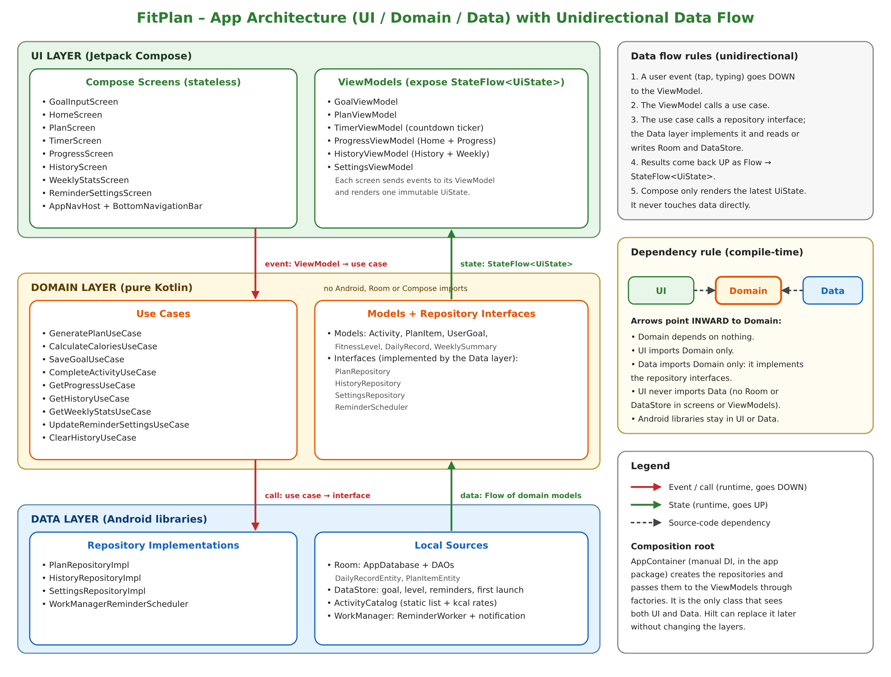

# FitPlan – Daily Activity Planner

CSC 402 Mobile Application Programming – **Group 4 (Team04)** | Instructor: Noura Alqahtani

FitPlan turns a daily calorie goal into a clear daily activity plan. The user enters a calorie goal, the available time and a fitness level (Beginner / Intermediate / Advanced). The app generates a plan (walking, cardio, running, stairs), runs a timer for each activity and tracks progress. All data is stored on the device. Built with Kotlin and Jetpack Compose.

## Features
| # | Feature | Priority |
|---|---------|----------|
| F1 | Goal & User Input | Must |
| F2 | Daily Plan Generation & Activity List | Must |
| F3 | Activity Timer | Must |
| F4 | Completion & Progress Tracking | Must |
| F5 | Local History | Must |
| F6 | Reminder Notifications | Should |
| F7 | Weekly Statistics | Could |

## Team
Layan Alshehri, Jouri Alshurie, Lina Alshehri, Buthaynah Fareed, Bayan Alqahtani, Mzoon Alqhtani, Kadi Alqahtani

## Architecture
FitPlan uses three layers (UI, Domain, Data) and unidirectional data flow: events go down, state goes up.

- **UI layer:** Compose screens, AppNavHost, ViewModels that expose `StateFlow<UiState>`.
- **Domain layer (pure Kotlin):** use cases, models and repository interfaces.
- **Data layer:** repository implementations, Room, DataStore, ActivityCatalog, WorkManager.
- **Dependency rule:** UI → Domain ← Data. The UI never imports the Data layer. Domain has no Android imports.
- **Dependency injection:** manual, with an `AppContainer` class.

## Navigation
Navigation Compose with four bottom-bar tabs: `home`, `plan`, `history`, `settings`.
Other routes: `goal_input`, `timer/{activityId}`, `progress`, `weekly_stats`.

## Jetpack components and libraries
Jetpack Compose + Material 3, Navigation Compose, ViewModel + Lifecycle, Kotlin Coroutines + Flow/StateFlow, Room, DataStore (Preferences), WorkManager + NotificationCompat, Compose Canvas, JUnit + Compose UI Test.
Details and reasons: [docs/Jetpack_Components_Libraries.md](docs/Jetpack_Components_Libraries.md)

## Documentation
- [Architecture diagram](docs/architecture.png)
- [Data model (Room and DataStore)](docs/Data_Model_Room_DataStore.md)
- [Jetpack components and libraries](docs/Jetpack_Components_Libraries.md)
- [Testing strategy](docs/Testing_Strategy.md)

## Milestones
| Milestone | Content | Tag |
|-----------|---------|-----|
| Milestone 2 – Stage 1 | UI prototype | – |
| Milestone 2 – Stage 2 | Architecture, Jetpack plan, GitHub documentation | `milestone-2-stage-2` |

## AI use
AI (Claude) was used as a design and writing aid. Every use is listed in the AI Use Log of our Milestone 2 submission.
